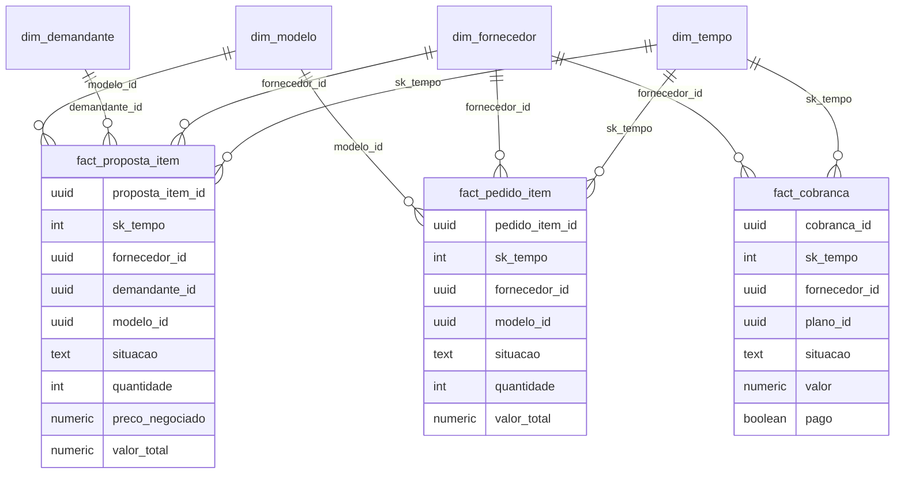

<p align="center">
  
</p>

# Data Mart de BI

O schema `bi` do `coredb` expõe o negócio em esquema estrela (Star Schema): quatro dimensões e três fatos, todos como views sobre as tabelas do Flyway. Os scripts estão em [`db/modelagem/10_star_schema.sql`](../db/modelagem/10_star_schema.sql) e [`db/modelagem/20_bi_views.sql`](../db/modelagem/20_bi_views.sql).



## Dimensões e fatos

| Objeto | Grão | Medidas ou atributos |
|---|---|---|
| `dim_tempo` | um dia | ano, trimestre, mês, `ano_mes`, dia da semana |
| `dim_fornecedor` | um fornecedor | nome fantasia, tipo de negócio, situação, estado, cidade |
| `dim_demandante` | um demandante | nome fantasia, tipo de negócio, estado, cidade |
| `dim_modelo` | um modelo de painel | modelo, marca, potência, eficiência, tipo |
| `fact_proposta_item` | um item de proposta | quantidade, preço negociado, desconto, valor total |
| `fact_pedido_item` | um item de pedido | quantidade, preço líquido, valor total |
| `fact_cobranca` | uma cobrança de assinatura | valor, forma de pagamento, pago |

O valor total de um item de proposta é o preço negociado vezes a quantidade, sem aplicar o desconto uma segunda vez, porque o preço negociado já o inclui.

## Views analíticas

Escritas com CTEs e funções de janela, para o painel de BI consumir direto:

| View | O que mostra | Funções de janela |
|---|---|---|
| `bi.vw_valor_aceito_mensal` | valor aceito por mês | `SUM() OVER` (acumulado), `LAG()` (variação), `AVG() OVER ... ROWS` (média móvel de 3 meses) |
| `bi.vw_ranking_fornecedores` | fornecedores pelo valor aceito | `RANK() OVER` geral e por estado, participação no total |
| `bi.vw_ranking_modelos` | modelos por unidades dentro da marca | `DENSE_RANK() OVER (PARTITION BY marca)` |
| `bi.vw_receita_assinaturas_mensal` | faturado e recebido por mês | `SUM() OVER` (recebido acumulado) |
| `bi.vw_rede_conexoes` e `bi.vw_alcance_conexoes` | rede de conexões até 3 graus | CTE recursiva e `SUM() OVER` |

## Como usar

```bash
make modelagem-apply DATABASE=core
make modelagem-check DATABASE=core
```

Os papéis de leitura (`ro_bootstrap`, `ro_databricks`) enxergam só o schema `export`. Para liberar o schema `bi` a um consumidor, acrescente-o ao contrato em `db/roles/contracts.json` e rode `make roles-apply`.
