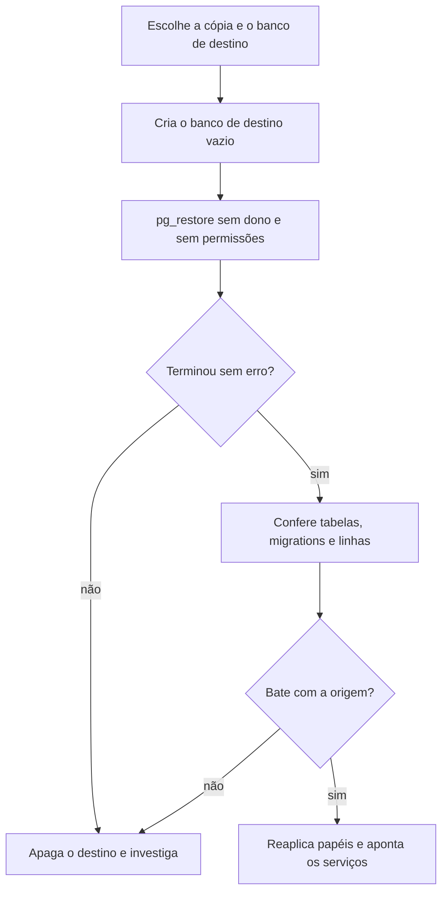

  

# Restauração PostgreSQL

Este fluxo traz um banco de volta a partir de uma cópia. Ele foi ensaiado na separação dos servidores de QA e de produção: o `coredb`, o `authdb` e o `dbmcp` de QA foram copiados para um servidor novo e conferidos.

## Passo a passo

1. Gere a cópia com `make backup` (arquivo SQL com data) ou, para restaurar com `pg_restore`, com `pg_dump -Fc --no-owner --no-acl -f copia.dump`.
2. Crie o banco de destino vazio, com um comando por vez (o `CREATE DATABASE` não roda dentro de transação): `psql "$MAINT_URI" -c "CREATE DATABASE coredb"`.
3. Restaure: `pg_restore -d "$DATABASE_URI" --no-owner --no-acl copia.dump`. Para uma cópia em SQL puro, use `psql "$DATABASE_URI" -f copia.sql`.
4. Confira o resultado antes de apontar qualquer serviço:
   - número de tabelas do schema `public` igual ao da origem;
   - `SELECT count(*) FROM flyway_schema_history` e as versões iguais às da origem;
   - número de linhas das tabelas principais igual ao da origem.
5. Reaplique os papéis, porque `--no-acl` descarta as permissões: `make roles-apply ENVIRONMENT=qa` e `make roles-check ENVIRONMENT=qa`.
6. Reaplique os scripts de modelagem: `make modelagem-apply`. Eles são idempotentes e recriam esquema estrela, auditoria, catálogo e DAU.
7. Aponte os serviços para o novo banco e acompanhe a subida.

## Resultado do ensaio

A cópia do `coredb` de QA tinha 29 MB, 68 tabelas, 3 migrations do Flyway e 4.593 linhas vivas. O `authdb` tinha 14 tabelas e 1 migration. Nos dois, as contagens do destino bateram com as da origem.

## Se algo der errado

- Erro de dono ou de permissão na restauração: use `--no-owner --no-acl`.
- Banco de destino com conexões ativas: encerre os serviços que usam o banco antes de apagá-lo ou renomeá-lo.
- Contagens diferentes: apague o destino e refaça a partir de uma cópia nova; não aponte o serviço.
- Servidor sem conexões livres: o plano pequeno do Postgres limita as conexões, então pare réplicas antes de restaurar.
